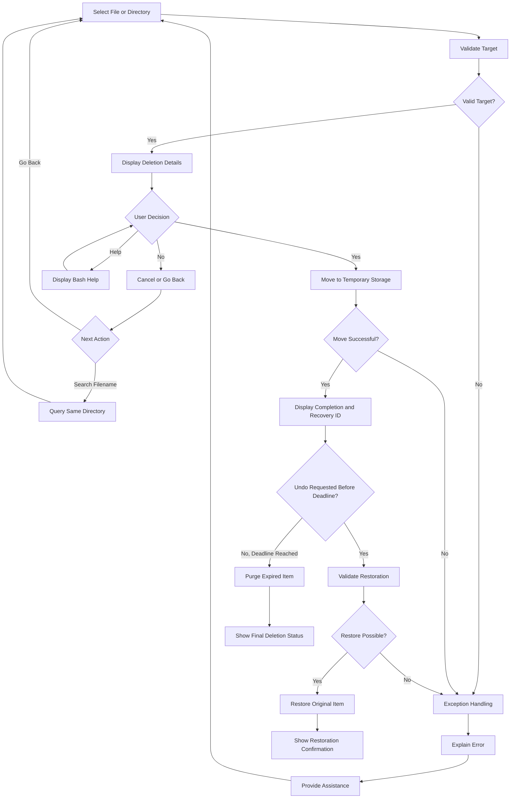
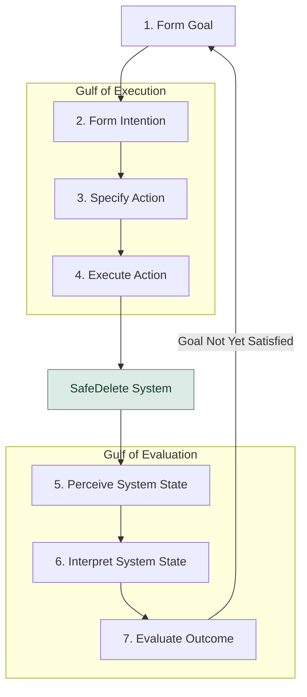
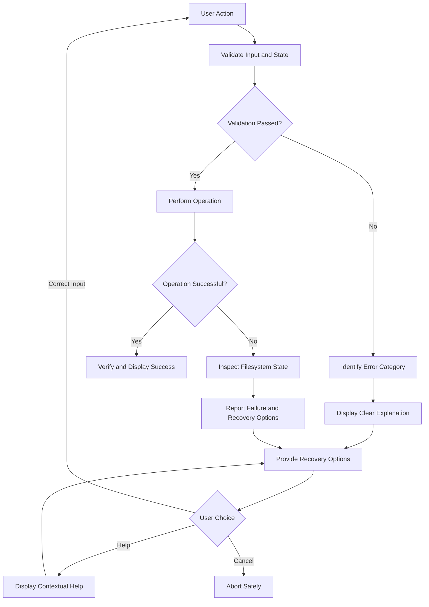
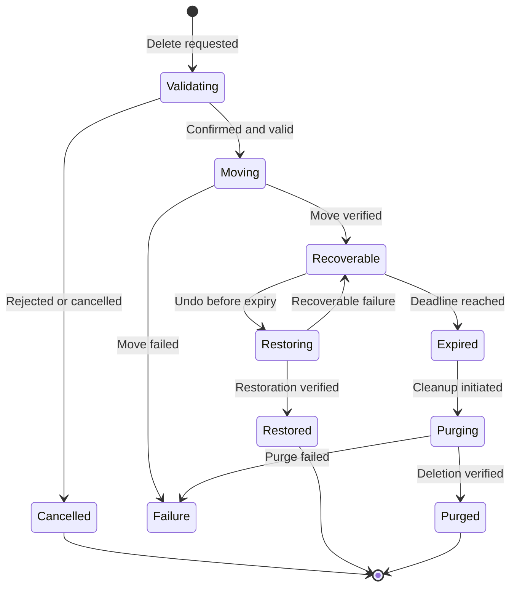

# SafeDelete — Human–Computer Interaction Design

## 1. Overview Command-Line Interface (CLI)

SafeDelete is a Linux/Bash library and command-line interface (CLI) for reversible deletion of files and directories. 

Instead of immediately deleting an item, SafeDelete moves it into temporary protected storage and makes it recoverable for a configurable period. After the recovery deadline, the item becomes eligible for permanent deletion.

The system applies Human–Computer Interaction (HCI) principles to improve error prevention, user control, system visibility, and recovery.

### 1.1 Objectives

- Prevent accidental or unintended permanent deletion.
- Validate file and directory operations before execution.
- Obtain explicit confirmation from the user.
- Provide progress indicators and meaningful feedback.
- Support time-sensitive Undo functionality.
- Handle errors with explanations and recovery options.
- Provide accessible command-line help.
- Minimize the Gulf of Execution and Gulf of Evaluation.

### 1.2 Main operations

| Operation | Description |
|---|---|
| Delete | Validate and move a file or directory to temporary storage |
| Confirm | Request explicit user approval before deletion |
| Cancel | Abort deletion without changing the target |
| Monitor | Display operation progress and status |
| List | Display recoverable items and remaining recovery time |
| Undo | Restore a deleted item before expiration |
| Purge | Permanently remove expired items |
| Help | Explain commands, options, and recovery procedures |
| Error recovery | Diagnose failures and provide corrective actions |

---

## 2. Hierarchical Task Analysis (HTA)

### 2.1 Primary goal

**Task 0: Safely delete a file or directory.**

The user must be able to remove a file or directory, verify the result, and restore the item within the configured recovery period.

### 2.2 Task hierarchy

```mermaid
flowchart TD
    T0["0. Safely Delete File or Directory"]

    T0 --> T1["1. Identify Target"]
    T0 --> T2["2. Validate Target"]
    T0 --> T3["3. Confirm Deletion"]
    T0 --> T4["4. Execute Decision"]
    T0 --> T5["5. Evaluate Result"]
    T0 --> T6["6. Manage Recovery"]

    T1 --> T11["1.1 Enter or Select Path"]
    T1 --> T12["1.2 Display Target Details"]

    T2 --> T21["2.1 Check Existence"]
    T2 --> T22["2.2 Check Permissions"]
    T2 --> T23["2.3 Check Protected Paths"]
    T2 --> T24["2.4 Detect Relevant Usage"]

    T3 --> T31["3.1 Display Consequences"]
    T3 --> T32["3.2 Yes / No / Help"]
    T3 --> T33["3.3 Validate Input"]

    T4 --> T41["4.1 Move to Temporary Storage"]
    T4 --> T42["4.2 Cancel or Go Back"]
    T4 --> T43["4.3 Handle Execution Errors"]

    T5 --> T51["5.1 Monitor Progress"]
    T5 --> T52["5.2 Display Completion"]
    T5 --> T53["5.3 Show Recovery Deadline"]

    T6 --> T61["6.1 List Recoverable Items"]
    T6 --> T62["6.2 Undo Deletion"]
    T6 --> T63["6.3 Purge Expired Items"]
```



### 2.3 Detailed task decomposition

#### Task 1 — Identify the target

- 1.1 Enter the file or directory path.
- 1.2 Resolve and display the selected target.
- 1.3 Display the filename, location, type, and size.
- 1.4 Allow the user to correct or change the target.

#### Task 2 — Validate the target

- 2.1 Verify that the target exists.
- 2.2 Verify the required filesystem permissions.
- 2.3 Reject protected system locations and unsafe paths.
- 2.4 Detect relevant running-process usage where technically possible.
- 2.5 Verify that temporary storage can accommodate the operation.
- 2.6 Display validation errors and recovery options.

#### Task 3 — Confirm deletion

- 3.1 Display the selected target.
- 3.2 Explain that deletion initially moves the target to temporary storage.
- 3.3 Display the configured recovery window.
- 3.4 Present Yes, No, and Help options.
- 3.5 Validate the user's response.
- 3.6 Route the user to the appropriate action.

#### Task 4 — Execute the decision

**If Yes:**

- 4.1 Move the target to protected temporary storage.
- 4.2 Record the original path, deletion ID, and expiration deadline.
- 4.3 Display progress for long-running operations.
- 4.4 Verify whether the operation completed successfully.

**If No:**

- 4.5 Cancel the deletion.
- 4.6 Offer the option to return to target selection.
- 4.7 Allow a filename query within the same directory.

**If Help:**

- 4.8 Display command usage and explanations.
- 4.9 Explain deletion, cancellation, restoration, and expiration.
- 4.10 Return to the confirmation step.

**If an exception occurs:**

- 4.11 Display an error explaining the failure.
- 4.12 Preserve the original item whenever possible.
- 4.13 Offer corrective actions or safe cancellation.

#### Task 5 — Evaluate the result

- 5.1 Display operation progress when applicable.
- 5.2 Display a completion or failure message.
- 5.3 Display the deletion ID and original location.
- 5.4 Display the remaining recovery time.
- 5.5 Display optional comments or deletion reason.
- 5.6 Provide the Undo command.

#### Task 6 — Manage recovery

- 6.1 List temporarily deleted items.
- 6.2 Display their expiration deadlines.
- 6.3 Allow the user to select an item for restoration.
- 6.4 Validate whether restoration is still permitted.
- 6.5 Check for conflicts at the original location.
- 6.6 Restore the item and display confirmation.
- 6.7 Permanently purge expired items.
- 6.8 Report unsuccessful restoration or purge operations.

### 2.4 HTA execution plan

**Plan 0**

1. Perform Tasks 1 and 2.
2. If validation fails, execute the error-handling procedure and return to Task 1 or 2.
3. If validation succeeds, perform Task 3.
4. If the user selects Yes, perform Tasks 4 and 5.
5. If the user selects No, cancel or return to Task 1.
6. If the user selects Help, display assistance and return to Task 3.
7. After successful deletion, Task 6 remains available until expiration.
8. After the deadline, permanently purge the item according to the configured cleanup policy.

---

## 3. Interaction and Decision Flow

The following diagram represents the confirmation branches and exception handling.



---

## 4. Norman's Seven Stages of Action

Norman's model describes interaction as seven stages connecting user goals, actions, system feedback, and outcome evaluation.

The seven stages are organized into two main groups:

- **Gulf of Execution:** the difficulty of determining and performing appropriate actions.
- **Gulf of Evaluation:** the difficulty of perceiving and interpreting the resulting system state.

### 4.1 Seven-stage interaction cycle



### 4.2 Mapping the seven stages to SafeDelete

| Stage | User activity | System support |
|---|---|---|
| 1. Form goal | Decide to remove an unwanted file safely | Clear purpose and terminology |
| 2. Form intention | Choose reversible rather than permanent deletion | Discoverable SafeDelete command |
| 3. Specify action | Select target and confirmation option | Visible commands and options |
| 4. Execute action | Confirm the deletion | Validation, execution, and error handling |
| 5. Perceive state | Observe progress and completion status | Progress and status messages |
| 6. Interpret state | Determine whether the file was temporarily or permanently deleted | Clear recovery status and deadline |
| 7. Evaluate outcome | Determine whether the file is removed and recoverable | Deletion ID, Undo action, and outcome verification |

---

## 5. Gulf of Execution

### 5.1 Definition

The Gulf of Execution represents the difference between what a user intends to accomplish and the actions the interface makes available.

The system should make it straightforward for the user to determine:

- Which file or directory is selected.
- Which actions are available.
- What Yes and No mean.
- Whether deletion can be reversed.
- How to access help.
- How to correct an incorrect selection.

### 5.2 Requirements

**GE-01 — Discoverability**

The available actions must be visible or easily discoverable through help commands.

**GE-02 — Clear action mapping**

Each option must have an unambiguous effect.

**GE-03 — Confirmation**

The system must display the exact selected target and the consequences before deletion.

**GE-04 — Input validation**

The system must reject invalid input without silently executing another action.

**GE-05 — Navigation and cancellation**

The user must be able to cancel or return to target selection.

**GE-06 — Context-sensitive help**

The system must explain valid commands and recovery procedures.

### 5.3 Example interface

```text
SafeDelete — Confirmation

Target: /home/user/Documents/report.pdf
Type: File
Size: 2.4 MB

This file will be moved to temporary storage.
Recovery window: 60 seconds.

Select an action:

[1] Yes — Move to temporary storage
[2] No — Cancel or select another file
[3] Help — Explain available actions

Choice [1/2/3]:
```

This interface reduces the Gulf of Execution by explicitly displaying the available actions and their consequences.

---

## 6. Gulf of Evaluation

### 6.1 Definition

The Gulf of Evaluation represents the difficulty users experience when determining whether the system has performed the intended operation.

After deletion, the user must be able to answer:

- Was the operation successful?
- Is the original file still present?
- Has the file been moved to temporary storage?
- Can it be restored?
- How much recovery time remains?
- Did an error occur?
- Has permanent deletion completed?

### 6.2 Requirements

**GV-01 — Visibility of system status**

Display the current operation and its status.

**GV-02 — Progress feedback**

Provide progress indicators for operations that take noticeable time.

**GV-03 — Completion feedback**

Display explicit success, failure, or cancellation messages.

**GV-04 — Recovery visibility**

Display the deletion ID, expiration deadline, and Undo command.

**GV-05 — Error transparency**

Explain why an operation failed and whether the original item was affected.

**GV-06 — Outcome verification**

Allow users to verify the final state through listing, status, or restoration commands.

### 6.3 Example successful deletion

```text
SafeDelete — Operation Completed

Status: SUCCESS

File: report.pdf
Original path: /home/user/Documents/report.pdf
Deletion ID: del_1042

The file has been moved to temporary storage.

Recovery window: 60 seconds
Remaining time: 60 seconds

To restore the file:

safedelete undo del_1042

To inspect recoverable files:

safedelete list
```

### 6.4 Example failed deletion

```text
SafeDelete — Operation Failed

Target: /home/user/Documents/report.pdf

Error: Permission denied.

The deletion was not completed.
The original file remains at its location.

Available actions:

[1] Return to selection
[2] Show permission help
[3] Cancel
```

Messages must reflect the actual verified filesystem state. If the outcome is uncertain following a partial failure, the system must report that uncertainty instead of claiming success or safe cancellation.

---

## 7. Exception Handling and Error Recovery

### 7.1 Error categories

| Code | Condition | Expected response |
|---|---|---|
| E001 | Target not found | Explain and allow path correction |
| E002 | Permission denied | Explain required access permissions |
| E003 | Protected system path | Reject deletion and explain restriction |
| E004 | Invalid confirmation input | Show accepted input values |
| E005 | File used by a process | Warn when detectable; apply configured policy |
| E006 | Temporary storage unavailable | Abort safely and explain the problem |
| E007 | Recovery deadline expired | Explain that Undo is unavailable |
| E008 | Restoration destination occupied | Offer safe conflict resolution |
| E009 | Operation interrupted | Inspect state and offer recovery |
| E010 | Partial transfer failure | Preserve available data and report the incomplete operation |
| E011 | Invalid or unknown deletion ID | Display lookup guidance |
| E012 | Concurrent operation conflict | Prevent conflicting operations and explain the condition |

### 7.2 Error-handling flow



### 7.3 Error-message design

Each error should communicate:

1. **What happened:** identification of the error.
2. **Why it happened:** understandable explanation where the cause is known.
3. **What was affected:** verified operation and filesystem status.
4. **What to do next:** available corrective actions.

Example:

```text
ERROR E008: Restoration destination occupied.

Original path:
  /home/user/Documents/report.pdf

A file with this name already exists.

Available actions:

[1] Restore using a different filename
[2] Select a different destination
[3] Cancel restoration

The temporarily stored item remains unchanged.
```

The system must not silently overwrite an existing file during restoration.

### 7.4 Linux-specific considerations

- An open file can often be unlinked on Linux while a process continues accessing its underlying data. Detecting process usage does not guarantee complete safety.
- Files and directories may require different handling, especially for large recursive structures.
- Symbolic links must be handled without unintentionally following their targets.
- Paths containing spaces, special characters, and newlines must be handled safely.
- Root and critical system paths must be protected.
- The temporary storage area must not be vulnerable to unauthorized modification.
- Operations should be safe under simultaneous requests.
- Same-filesystem moves and cross-filesystem transfers have different atomicity guarantees.
- Expiration does not guarantee that physical data has been securely erased.

---

## 8. Time-Sensitive Undo

### 8.1 Functional behavior

Every successful reversible deletion must produce a record containing at least:

| Field | Description |
|---|---|
| Deletion ID | Unique identifier |
| Original path | Original file or directory location |
| Storage reference | Protected temporary storage location |
| Deletion timestamp | Time the operation was completed |
| Expiration timestamp | Deadline for restoration |
| Status | Recoverable, restoring, expired, purging, restored, or purged |
| Optional comment | User-supplied reason or description |

### 8.2 Recovery lifecycle



### 8.3 Expiration requirements

- The recovery duration must be configurable.
- The system must record an absolute expiration timestamp.
- The system must calculate remaining time accurately.
- Undo requests after expiration must be rejected according to policy.
- Expired entries must be removed by an explicit or scheduled cleanup process.
- Permanent deletion must not be reported as complete until the purge succeeds.
- Cleanup failures must be logged or displayed and remain eligible for retry.

---

## 9. Mapping HTA Tasks to Norman's Stages

| HTA task | Norman stage | Primary HCI concern |
|---|---|---|
| 1. Identify target | Form intention / Specify action | Gulf of Execution |
| 2. Validate target | Specify / Execute action | Error prevention |
| 3. Confirm deletion | Specify action | Gulf of Execution |
| 4. Execute decision | Execute action | Action reliability |
| 5. Evaluate result | Perceive / Interpret state | Gulf of Evaluation |
| 6. Manage recovery | Evaluate outcome / Form new goal | Both gulfs |

The Undo operation initiates a new Norman action cycle: the user forms the goal of restoring a file, identifies the restoration command, executes it, observes the result, and evaluates whether the file was successfully recovered.

---

## 10. Usability Requirements

| ID | Requirement | Related principle |
|---|---|---|
| UX-01 | Every destructive action requires explicit confirmation | Error prevention |
| UX-02 | The target and consequences must be visible | Gulf of Execution |
| UX-03 | The user can cancel without changing the target | User control and freedom |
| UX-04 | Successful deletion provides a recoverable item ID | Visibility of system status |
| UX-05 | The Undo mechanism is discoverable | User control and freedom |
| UX-06 | The recovery deadline is clearly communicated | Gulf of Evaluation |
| UX-07 | Errors explain causes and possible corrective actions | Error recovery |
| UX-08 | The interface uses consistent terminology and commands | Consistency |
| UX-09 | Help is accessible from the interaction context | Recognition rather than recall |
| UX-10 | File operations display accurate final-state feedback | Gulf of Evaluation |
| UX-11 | Restoration conflicts never cause silent overwriting | Error prevention |
| UX-12 | Keyboard interaction is supported throughout | Accessibility |

---

## 11. Usability Evaluation Scenarios

### Scenario A — Successful deletion

**Goal:** Delete a file while retaining the ability to recover it.

Expected behavior:

1. The user selects the target.
2. The system validates it.
3. The user confirms deletion.
4. The system moves the file to temporary storage.
5. The system displays confirmation and recovery information.

Evaluation criteria:

- Task completion success.
- Correct identification of the target.
- Understanding of the deletion consequences.
- Understanding of the recovery deadline.

### Scenario B — Accidental deletion request

**Goal:** Cancel an unintended deletion.

Expected behavior:

1. The user selects an incorrect file.
2. The confirmation interface identifies the target.
3. The user selects No.
4. The system cancels without modifying the target.
5. The system confirms cancellation.

Evaluation criteria:

- Cancellation discoverability.
- Prevention of unintended deletion.
- Clarity of cancellation feedback.

### Scenario C — Undo deletion

**Goal:** Restore a recently deleted file.

Expected behavior:

1. The user lists recoverable items.
2. The user identifies the desired deletion ID.
3. The user selects Undo before expiration.
4. The system validates the restoration destination.
5. The file is restored.
6. The system displays confirmation.

Evaluation criteria:

- Undo discoverability.
- Time required to locate the deleted item.
- Restoration success.
- Clarity of final-state feedback.

### Scenario D — Exception handling

**Goal:** Recover from an invalid or unsuccessful operation.

Expected behavior:

1. The user attempts an invalid operation.
2. The system detects the condition.
3. The system explains the error.
4. The system displays corrective actions.
5. The user corrects the problem or cancels.

Evaluation criteria:

- Error comprehension.
- Quality of recovery guidance.
- Ability to recover without unintended data loss.

### Scenario E — Recovery period expired

**Goal:** Understand why restoration is no longer available.

Expected behavior:

1. The user attempts Undo after expiration.
2. The system rejects the restoration request.
3. The system explains the expired deadline.
4. The system reports whether permanent purge has completed.

Evaluation criteria:

- Accuracy of expiration feedback.
- Distinction between expiration and completed purge.
- Understanding of the final item state.

---

## 12. Suggested Implementation Structure

```text
safedelete/
├── bin/
│   └── safedelete
├── lib/
│   ├── validation.sh
│   ├── confirmation.sh
│   ├── deletion.sh
│   ├── recovery.sh
│   ├── storage.sh
│   ├── progress.sh
│   ├── help.sh
│   └── errors.sh
├── tests/
│   ├── test_validation.sh
│   ├── test_deletion.sh
│   ├── test_recovery.sh
│   ├── test_expiration.sh
│   └── test_exceptions.sh
├── README.md
└── HCI_DESIGN.md
```

### 12.1 Main Bash functions

```bash
validate_target()
confirm_deletion()
safe_delete()
monitor_progress()
list_deleted()
undo_delete()
purge_expired()
handle_error()
show_help()
```

The implementation should separate filesystem operations from interaction logic. Validation, deletion, restoration, and storage functions should return explicit success or failure information so the CLI can communicate the correct state.

---

## 13. Acceptance Criteria

The implementation satisfies the defined HCI requirements when:

- Users can identify the exact deletion target before confirmation.
- Invalid or ambiguous confirmation inputs do not trigger deletion.
- Cancelled operations do not modify the selected target.
- Successful deletions preserve recoverable items until expiration.
- Users can discover and perform Undo without relying on memorized identifiers alone.
- Progress is communicated for operations that take noticeable time.
- Completion messages accurately describe the verified operation state.
- Restoration destination conflicts are handled safely.
- Expiration and permanent purge are distinguishable system states.
- All defined error categories produce understandable feedback.
- Help and recovery guidance are available at relevant interaction points.
- The two gulfs can be evaluated through observable user tasks and outcomes.
